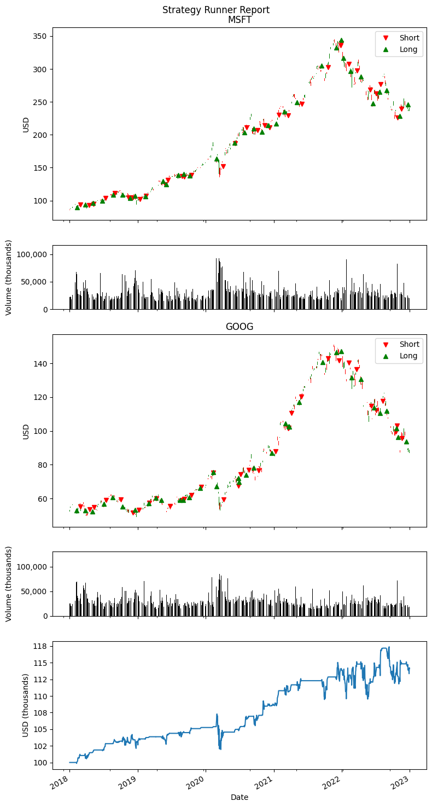

# yabte - Yet Another BackTesting Engine

Python module for backtesting trading strategies.

Features

* Event driven, ie `on_open`, `on_close`, etc. 
* Daily or intraday bars. Book end-of-day tasks run once per date, after its last bar.
* Multiple assets.
* OHLC Asset, filling orders at the High/Low midpoint, the Open or the Close. Extendable (e.g support additional fields, e.g. Volatility, or entirely different fields, e.g. Barrels per day).
* Multiple books, each with optional interest on cash.
* Positional and Basket orders. Extendible (e.g. can support stop loss).
* Batch runs (for optimization).
* Captures book history including transactions & daily cash, MtM and total values.
* Missing prices raise `MissingPriceError` when a run needs them, and `find_missing_data` lists gaps before a run.

The module provides basic statistics like book cash, mtm and total value. Currently, everything else needs to be deferred to a 3rd party module like `empyrical`.

### Accelerated C++ Backend

A C++ backend supports most of the objects in the pure Python module. Select it with
`StrategyRunner(..., engine="cpp")`; both engines give the same results for the same
strategy. Strategies written in Python run on it unchanged, and strategies written
natively in C++ also run in parallel in `run_batch`.

The C++ backend has some limits:

* Mandates raise `ValueError` and basket orders raise `NotImplementedError`.
* Asset and order subclasses that override a pricing or execution hook, such as
  `intraday_traded_price` or `pre_execute_check`, raise `NotImplementedError`, because
  the C++ engine would ignore the override. For a different fill price, use
  `OHLCAsset(fill_price="open")` or `"close"`, which both engines support.

## Core dependencies

The core module uses pandas, scipy and pyarrow. pyarrow is pinned to 23.x because the
C++ extension links against it.

## License

This library is licensed under the [MIT License](LICENSE).

Wheels that include the C++ engine also contain third-party code compiled into the
extension; its licence notices ship alongside it as
`yabte/backtest/THIRD_PARTY_LICENSES.txt`.

## Installation

```bash
pip install yabte
```

Wheels include the C++ engine for CPython 3.12 to 3.14 on Linux x86_64. A source
install tries to build it and falls back to pure Python if that fails. Set
`YABTE_BUILD_CPP=0` to skip the build.

## Usage

Below is an example usage (the economic performance of the example strategy won't be good).

```python
import pandas as pd

from yabte.backtest import Book, SimpleOrder, Strategy, StrategyRunner
from yabte.tests._helpers import generate_nasdaq_dataset
from yabte.utilities.plot.plotly.strategy_runner import plot_strategy_runner_result
from yabte.utilities.strategy_helpers import crossover


class SMAXO(Strategy):
    def init(self):
        # enhance data with simple moving averages

        p = self.params
        days_short = p.get("days_short", 10)
        days_long = p.get("days_long", 20)

        close_sma_short = (
            self.data.loc[:, (slice(None), "Close")]
            .rolling(days_short)
            .mean()
            .rename({"Close": "CloseSMAShort"}, axis=1, level=1)
        )
        close_sma_long = (
            self.data.loc[:, (slice(None), "Close")]
            .rolling(days_long)
            .mean()
            .rename({"Close": "CloseSMALong"}, axis=1, level=1)
        )
        self.data = pd.concat(
            [self.data, close_sma_short, close_sma_long], axis=1
        ).sort_index(axis=1)

    def on_close(self):
        # create some orders

        for symbol in ["GOOG", "MSFT"]:
            df = self.data[symbol]
            ix_2d = df.index[-2:]
            data = df.loc[ix_2d, ("CloseSMAShort", "CloseSMALong")].dropna()
            if len(data) == 2:
                if crossover(data.CloseSMAShort, data.CloseSMALong):
                    self.orders.append(SimpleOrder(asset_name=symbol, size=-100))
                elif crossover(data.CloseSMALong, data.CloseSMAShort):
                    self.orders.append(SimpleOrder(asset_name=symbol, size=100))


# load some data
assets, df_combined = generate_nasdaq_dataset()

# create a book with 100000 cash
book = Book(name="Main", cash="100000")

# run our strategy
sr = StrategyRunner(
    data=df_combined,
    assets=assets,
    strategies=[SMAXO()],
    books=[book],
)
srr = sr.run()

# see the trades or book history
th = srr.transaction_history
bch = srr.book_history.loc[:, (slice(None), "cash")]

# plot the trades against book value
plot_strategy_runner_result(srr, sr)
```



## Examples

Jupyter notebook examples can be found under the [notebooks folder](https://github.com/bsdz/yabte/tree/main/notebooks):

- **Readme_Example**: the example above, explained step by step.
- **Engines_and_Parameter_Sweeps**: the Python and C++ engines, native C++ strategies, and parallel parameter sweeps with `run_batch`.
- **Orders_and_Assets**: order sizing, positional orders, priority, limit orders, replacing orders by key, follow-on orders, and custom assets.
- **Books_Interest_and_Mandates**: multiple books, interest on cash, and mandates.
- **Intraday_Bars**: five-minute bars, an opening range breakout, and intraday equity from daily book history.
- **Simulation**: Wiener, GBM and Heston simulations, and backtesting on simulated data.
- **Portfolio_Optimization**: comparing portfolio optimisation schemes.
- **Delta_Hedging**: delta hedging an option under constant and stochastic volatility.
- **Pyfolio_Example**: pyfolio tear sheets from backtest results.

## Agent skill

yabte ships a skill that teaches coding agents its API: data and assets, strategies,
orders, books, the two engines and parameter sweeps. To copy it into a project's
`.claude/skills/` and `.agents/skills/`, run this from the project root:

```bash
yabte-install-skill
```

Use `--dest DIR` to install it somewhere else, such as `~/.claude/skills`. An existing
copy that differs is only replaced with `--force`.

## Documentation

Documentation can be found on [Read the Docs](https://yabte.readthedocs.io/en/latest/).


## Development

Before commit run following format commands in project folder:

```bash
nox --session do-lint
```

### Further development

Support subinterpreters in C++ backend.

### Build C++

The build type is part of the session name. Without one, nox runs both Debug and
Release.

```bash
nox --session "build-cpp(debug)"    # or build-cpp(release)
```

Tests run against a build of the same type, so build it first:

```bash
nox --session "test-3.14(debug)"    # or test-3.14(release)
```

#### Clean

```bash
nox --session "clean-cpp(debug)"    # or clean-cpp(release)
```
